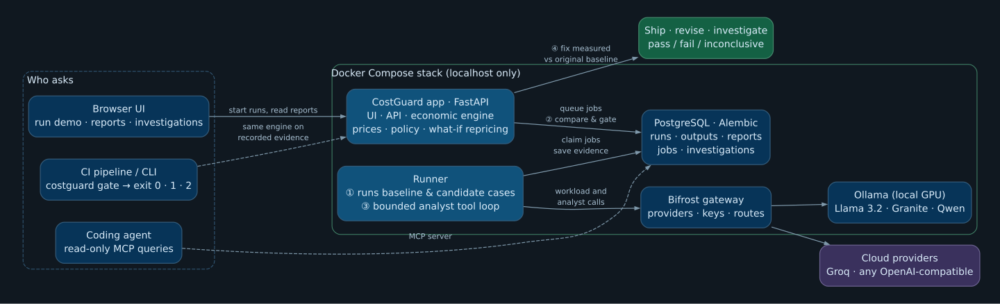

# CostGuard

**Find out what an AI change will cost before it ships.**

CostGuard runs the same cases on a baseline and a candidate version of an AI workload (a new prompt, model, or tool path), records what really happened (tokens, latency, retries, steps, outputs and quality), prices both on one explicit catalog, and applies your policy: **pass**, **fail**, or **inconclusive** when the evidence is incomplete. An analyst model can then investigate the comparison through bounded, read-only tools and propose one prompt experiment, which you approve, run, and measure against the original baseline.

It is a local-first prototype. For the longer-term direction see [VISION.md](VISION.md).



Circled numbers follow one comparison: ① run both variants, ② compare and gate, ③ the analyst investigates, ④ its fix is measured against the original baseline. Source: [docs/costguard-architecture.dot](docs/costguard-architecture.dot).

## Real-model demo (local or cloud)

The demo suite ([examples/support_triage.json](examples/support_triage.json)) routes 8 customer-support messages to `billing`, `technical`, `account` or `shipping`:

- **Baseline** prompt: "reply with the category name only".
- **Candidate** prompt: a friendlier, "more thorough" rewrite that restates the problem, reasons step by step and drafts a reply. It looks harmless in review.

Policy: cost per request may rise at most 20 %, and quality may not fall below the baseline. The suite runs at temperature 0, so repeated runs give the same answers. Recorded on a laptop RTX 3070 Ti with `llama3.2:3b` as the workload and `granite4.2:8b` as the analyst:

| Step | Result |
| --- | --- |
| Candidate vs baseline | **+1,009 % cost per request**, 6/8 → 0/8 correct (verbose answers break the label); policy **fail** |
| Investigation (3.5 min, 5 calls) | Output grew from 2 to 278 tokens and the format broke; proposes a label-only prompt that still allows an optional one-sentence restatement |
| First fix vs original baseline | Cost +19.6 %, but only 2/8 correct: the restatement breaks the label again; **fail** |
| Investigating that result | Identifies the restatement and proposes the strict baseline wording |
| Second fix vs original baseline | Same cost, 6/8 correct like the baseline; **pass** |

The two workload runs take about a minute on the GPU, and each investigation about 3–4 minutes (10–15 minutes on CPU). The 3B model misroutes two messages even with the baseline prompt, which is why the policy compares against the baseline rather than an absolute score. `make restore` loads this recorded session ([demo/snapshot.sql](demo/snapshot.sql)) as a fallback when a live model is unavailable. The presenter script with timings and fallbacks is [docs/DEMO.md](docs/DEMO.md).

### Local models with Ollama (free)

```bash
cp .env.example .env            # then replace the passwords and Bifrost secrets
docker compose --profile local up -d --build --wait
docker compose --profile local exec ollama ollama pull llama3.2:3b-instruct-q4_K_M   # workload, 2.0 GB
docker compose --profile local exec ollama ollama pull qwen3.5:4b-q4_K_M             # analyst, 3.3 GB
docker compose --profile local exec app python -m costguard.bootstrap_gateway ollama
```

The last command registers Ollama and its pulled models in the Bifrost gateway with a 300-second request timeout (or raises a shorter timeout on an existing Ollama provider). Then open **<http://localhost:8000>**, choose `ollama/llama3.2:3b-instruct-q4_K_M`, and click **Run baseline and candidate**. The report opens when both runs finish. Click **Investigate this comparison**, pick the analyst on **Connections** if you want a different one, and start the investigation.

| Model | Ollama tag | Download | Good for |
| --- | --- | ---: | --- |
| Llama 3.2 3B Instruct | `llama3.2:3b-instruct-q4_K_M` | 2.0 GB | Workload: fast and follows the label format; too weak as an analyst |
| Qwen 3.5 4B | `qwen3.5:4b-q4_K_M` | 3.3 GB | Analyst: completes investigations, but its findings contained factual slips |
| Granite 4.2 8B | `granite4.2:8b-q4_K_M` | 5.3 GB | Analyst: the most accurate findings; fits an 8 GB GPU (6.6 GB loaded) |

**NVIDIA GPU (optional, much faster):** install the [NVIDIA Container Toolkit](https://docs.nvidia.com/datacenter/cloud-native/container-toolkit/latest/install-guide.html), generate its CDI spec (`sudo nvidia-ctk cdi generate --output=/etc/cdi/nvidia.yaml`), restart Docker, then add `compose.gpu.yaml`: `docker compose -f compose.yaml -f compose.gpu.yaml --profile local up -d --wait`, or set `COMPOSE_FILE=compose.yaml:compose.gpu.yaml` in `.env`. `docker compose exec ollama ollama ps` should then show `GPU` under PROCESSOR.

Qwen and Granite are reasoning models: they think before answering, and the hidden reasoning tokens are billed as output. As the *workload* they are a poor fit for this suite. Granite used 125 output tokens to answer `billing`, and under the candidate prompt both spent the whole 400-token limit thinking and returned an empty answer; CostGuard records that as real cost and a quality miss. As the *analyst* they need room to think: the demo sets the analyst's output limit to 4,096 tokens, and a lower limit fails with a message naming it.

Small models are weak analysts: `llama3.2:3b` often answers in prose instead of calling tools, and CostGuard deliberately does not accept prose as a conclusion. Use Granite, Qwen or a cloud model for investigations, and choose the analyst on **Connections** (or pass `--keep-analyst` to the terminal demo). Ollama loads one model and serves one request at a time, with an 8K context; adjust `OLLAMA_MAX_LOADED_MODELS`, `OLLAMA_NUM_PARALLEL` and `OLLAMA_CONTEXT_LENGTH` in `.env` if the host has the memory.

### Cloud models

```bash
docker compose --profile gateway up -d --build --wait
```

Open Bifrost at <http://localhost:8080> (`BIFROST_PORT` in `.env` changes the port if 8080 is taken; setup token in `.env`), finish its admin setup, and add a provider with its API key. Provider keys stay in Bifrost; CostGuard never stores them. Back on the CostGuard overview, choose the provider's `provider/model` ID and **enter the provider's real per-token prices**, then run the demo. The demo makes 16 workload calls; each investigation call is recorded and priced separately. If inference requires a Bifrost virtual key, set `BIFROST_VIRTUAL_KEY` in `.env` and recreate the app and runner.

Measured on Groq with `groq/qwen/qwen3.8-27b` as both workload and analyst, at the prices Bifrost's model catalog lists ($0.80 / $4.00 per million input/output tokens):

| Step | Result |
| --- | --- |
| Candidate vs baseline | **+2,204 % cost per request** ($6.66 → $153.44 per 100k requests), quality 1.0 → 0; policy **fail** |
| Investigation (4 calls, $0.017) | Findings attribute the increase to output volume (2 → 334–400 tokens per case) with unchanged calls and steps; proposes the strict label prompt |
| Proposal vs original baseline | Same cost and quality 1.0; policy **pass** |

The whole cloud test, including probes, cost about $0.035. Free-tier provider limits are small (Groq allowed 8,000 tokens per minute for this model): CostGuard waits out `429` responses, which providers reject before processing, using the provider's `Retry-After` for up to three minutes per request. The wait is recorded on the call as `rate_limit_wait_ms` and kept out of measured latency.

### From a terminal

```bash
docker compose --profile local exec app python -m costguard demo \
  --model ollama/llama3.2:3b-instruct-q4_K_M --investigate
```

This runs both variants, saves and prints the comparison, and (with `--investigate`) asks the analyst for findings. Use `--input-price/--output-price` for real prices and `--keep-analyst` to keep the analyst already configured on Connections; otherwise the demo model becomes the analyst.

### About the prices

A local model has no per-token bill, so the demo prefills **notional reference rates** ($0.10 / $0.40 per million input/output tokens). They exist so the cost difference is visible; they are not any provider's price. Every report names the pricing version it used, and both variants are always priced on the same catalog.

## Offline mock demo

`COSTGUARD_DEMO=1 docker compose --profile demo up -d --build --wait` adds a deterministic mock provider and a scripted mock analyst, and shows an **Offline mock demo** button. It needs no model and is what CI uses; it proves the workflow, not model reasoning.

## Using it on your own workload

- `python -m costguard run <spec.json> --wait` or `POST /api/v1/jobs`: a case suite with a prompt and model. Cases may carry `expected_text`, scored by the `exact` evaluator or, with `"evaluator": "normalized"`, ignoring case, surrounding punctuation, quotes and Markdown emphasis. An optional `temperature` is sent to the provider (the demo suite uses 0 so repeated runs are comparable; otherwise the provider default applies and answers vary between runs). Each run has case, time, retry, step, tool, output-token and optional spend limits.
- **Import** evidence from your own application: `POST /api/v1/artifacts` or `python -m costguard import <file>` with a versioned JSON execution artifact (case IDs, model calls, usage provenance, latency, steps, optional output, quality and non-model charges).
- **Python hook**: `costguard.hook.ArtifactRecorder` wraps each case in an existing app; record actual OpenAI-compatible responses plus tool/retrieval steps and optional quality, then export `recorder.artifact().model_dump_json()`. It does not intercept SDK calls automatically.
- `POST /api/v1/comparisons`: compare two saved runs on one pricing catalog with a cost-regression and optional quality threshold and monthly traffic. The **Reports** page lists every comparison.
- **What if prices change?** on each report (or `POST /api/v1/scenarios`, `python -m costguard scenario`): reprice both observed runs under other per-token prices and traffic, holding behavior fixed. This is not a prediction of a different model's behavior.

## Evidence and decisions

- Reports compare matched cases: mean and p95 cost/latency, per-case and per-model attribution, model calls, retries, tool/agent steps, paired quality, and an optional monthly projection.
- Policies can gate cost per request, regression percentage, projected monthly cost, latency, quality (an absolute minimum, or `max_quality_drop`: how far the candidate may score below the baseline on the same cases; the demo suite allows no drop), retries, steps and model calls.
- The result is **inconclusive**, never a false pass, when cases fail, usage is missing or estimated, prices are missing, case sets differ, or a quality policy is set but not every case has paired scores. A failed attempt without usage counts as missing usage because it may still be billed, so a run with retries is inconclusive even when the retry succeeded.
- Money is computed with exact decimals and serialized as fixed-point decimal strings in JSON.
- Rate-limited (`429`) requests are re-sent after the provider's `Retry-After`, because the provider did not process them. No other failed request is re-sent automatically.
- `python -m costguard gate --baseline <a.json> --candidate <b.json> --pricing <p.json> --policy <policy.json>` exits 0 for pass, 1 for fail and 2 for inconclusive/error; `--json-output` and `--markdown-output` export reports for CI.
- `python -m costguard.mcp_server` exposes read-only MCP queries for saved runs, comparisons and investigations; it never initiates paid calls.
- The original stateless `POST /compare` endpoint remains, with [examples/comparison.json](examples/comparison.json).

## Investigations

The analyst model is configured on **Connections** (`provider/model`, explicit prices, pricing version, call/token/time/spend limits) separately from the workload model, and is snapshotted per investigation. The runner executes a bounded tool loop: inspect the comparison, inspect cases (calls, usage, quality and recorded output), optionally propose one system-prompt experiment, and finish with findings that may cite only evidence returned on earlier turns. Correctable tool mistakes are explained back to the analyst; prose is never accepted as a conclusion.

The investigation page leads with the findings, links each cited case to its row in the report, and marks every number in a finding that does not appear (at the precision written) in the evidence the analyst inspected. That is a presence check: it catches invented figures, not wrong reasoning, and it also flags numbers the analyst derived correctly. Findings are model interpretations; validated references do not prove every claim, and numerical policy results always come from the deterministic engine. Analyst calls and spend are recorded before each call, with no automatic retry or replay after a lost lease. Spend thresholds are checked between calls and are not hard caps on in-flight charges; missing analyst usage stops the loop with unknown cost. Running a proposal preserves the source cases, model, pricing and limits, is queued once, and is compared against the original baseline and policy. Imported artifacts can be investigated, but a proposal requires the candidate's original CostGuard job specification.

The analyst receives the selected report and configuration and any case inputs and outputs it requests. Run outputs (up to 2,000 characters per case) are stored in PostgreSQL with the rest of the evidence.

## Make targets

`make up` (build and start the local stack), `make models` (pull the demo models and register them in Bifrost), `make demo` (workload runs plus an investigation from the terminal), `make test`, `make e2e`, `make gate` (CI cost gate), `make snapshot` / `make restore` (save or load the database, e.g. the recorded demo), `make down`. They use `--profile local`; add `compose.gpu.yaml` through `COMPOSE_FILE` in `.env` for the GPU.

## Verify

```bash
docker compose --profile demo run --rm --no-deps app python -m unittest discover -v
COSTGUARD_DEMO=1 docker compose --profile demo up -d --build --wait
docker compose --profile demo exec -T app python -m tests.e2e
```

The end-to-end check adds demo runs and comparisons, but restores your analyst settings and removes the test-only records it creates. GitHub Actions runs both checks on the demo stack.

### Cost gate in CI

`bash examples/ci/gate.sh` runs `costguard gate` in the app container on recorded support-triage runs ([examples/ci](examples/ci)). The verbose candidate prompt is blocked (exit 1) and the analyst's fix passes against the original baseline (exit 0). GitHub Actions runs it on every push and writes both results as tables to the job summary. In your own pipeline, run `costguard gate` on your recorded baseline and candidate: its non-zero exit fails the job.

## Services and security

The stack has the app (API, UI and docs at `localhost:8000/docs`), a sequential runner for experiments and investigations, PostgreSQL, and Bifrost (`localhost:8080`); Ollama and the mock provider are profile-specific. The app runs its database migrations on startup; data lives in named volumes. All published ports bind to localhost. The app rejects unexpected `Host` headers and state-changing requests from other origins (`COSTGUARD_ALLOWED_HOSTS` adjusts the host list), and containers run as a non-root user. Bifrost's dashboard and API are unprotected until you finish its admin setup.

## Prototype boundaries

Single-user and local-first. It does not capture production traces, routing probabilities, weighted traffic, automatic instrumentation, RAG behavior, or quality beyond explicit case evaluators. Gateway-internal activity is not fully observed. Do not expose this stack publicly without authentication, TLS and secret management.
