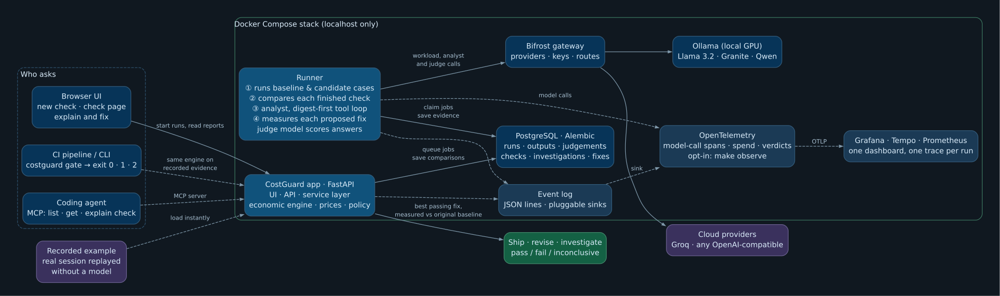

# CostGuard

**Find out what an AI change will cost before it ships.**

A **check** runs the same cases on a baseline and a candidate version of an AI workload (a new prompt, model or tool path). CostGuard records what really happened (tokens, latency, retries, steps, outputs, quality), prices both on one explicit catalog and applies your limits: **pass**, **fail**, or **inconclusive** when the evidence is incomplete. When a check fails, an analyst model explains why from evidence CostGuard has already computed and proposes up to three fixes. One click measures every fix against the original baseline, and the cheapest one that passes your limits is highlighted.

It is a local-first prototype. For the longer-term direction see [VISION.md](VISION.md).



Circled numbers follow one check: ① run both versions, ② compare and gate, ③ the analyst explains and proposes fixes, ④ each fix is measured against the original baseline. Source: [docs/costguard-architecture.dot](docs/costguard-architecture.dot).

## Try it in two minutes (no model needed)

```bash
cp .env.example .env            # then replace the passwords and Bifrost secrets
make up                         # app, runner, PostgreSQL, Bifrost and Ollama
make recorded                   # or click "Load the recorded example" on http://localhost:8000
```

The recorded example is a real session replayed instantly, with no model, gateway or GPU: a friendlier prompt for a support-triage workload costs **+1,045 % per request** and breaks the labels (6/8 → 0/8 correct), so the check **fails** two limits. The analyst, in 2 calls and $0.002 at the notional rates, finds that the output grew from 2 to about 270 tokens and proposes three prompts. Measured against the original baseline, all three pass (0 %, −11 % and −20 % cost); the cheapest is highlighted. Replays are labelled "Recorded example" and their verdicts are recomputed from the recorded runs on every load. Re-record it with `python -m costguard record <check-id> <investigation-id>` after changing prompts or the analyst.

## How a check works

1. **New check** (`/checks/new`): choose a model, edit the two prompts, the cases, how answers are scored and your limits. Two presets are included: [support triage](examples/support_triage.json) (a label match) and [refund replies](examples/refund_reply.json) (judged by a model against a rubric).
2. **Run**: the runner executes both versions at temperature 0 and, when the second finishes, compares them by itself. The progress page shows each answer as it arrives.
3. **Check page** (`/checks/{id}`): the verdict, each limit beside what was measured, headline numbers, the prompt diff, why the cost changed, every case, and a what-if that reprices the measured tokens at other prices (behavior held fixed; not a prediction).
4. **Explain and fix**: the analyst reads a digest (limits, cost drivers, prompt change, the cases that changed) and may inspect a case. It proposes one to three prompts and cannot run anything. **Test the fixes** queues them; each is compared with the original baseline and limits when it finishes. Findings are checked: every number the analyst quotes must appear in the evidence it was given (a presence check, not proof).

### How answers are scored

| Evaluator | Scores an answer as correct when |
| --- | --- |
| `exact` | it equals the expected answer, ignoring case |
| `normalized` | it equals the expected answer, also ignoring surrounding punctuation, quotes and Markdown emphasis |
| `llm_judge` | a pinned judge model (temperature 0, strict JSON verdict) says it meets your rubric |

A judge's verdict is a model's opinion, shown with its reason beside each answer. If it gives no usable verdict the answer has no score, and a quality limit becomes **inconclusive**, never a pass. Judge calls are priced on their own and reported apart from the workload cost. Small local models make weak judges: a 3B model could not count words in a rubric, and a reasoning model may spend its whole token budget thinking, so keep rubrics to what the judge can read or route it to a stronger model through the gateway.

## Real models

### Local models with Ollama (free)

```bash
make up
make models          # pulls llama3.2:3b (workload) and granite4.2:8b (analyst), registers them in Bifrost
make warm            # loads the workload model so the first run does not wait
```

Open <http://localhost:8000/checks/new>, pick the model (the page lists what the gateway offers) and run. The analyst is configured on **Connections** (tick "use this model as the analyst" on the form to use the same model).

| Model | Ollama tag | Download | Good for |
| --- | --- | ---: | --- |
| Llama 3.2 3B Instruct | `llama3.2:3b-instruct-q4_K_M` | 2.0 GB | Workload: fast and follows the label format; too weak as an analyst or judge |
| Qwen 3.5 4B | `qwen3.5:4b-q4_K_M` | 3.3 GB | Analyst: completes investigations, but its findings contained factual slips |
| Granite 4.2 8B | `granite4.2:8b-q4_K_M` | 5.3 GB | Analyst: the most accurate findings; fits an 8 GB GPU (6.6 GB loaded) |

**NVIDIA GPU (optional, much faster):** install the [NVIDIA Container Toolkit](https://docs.nvidia.com/datacenter/cloud-native/container-toolkit/latest/install-guide.html), generate its CDI spec (`sudo nvidia-ctk cdi generate --output=/etc/cdi/nvidia.yaml`), restart Docker, then set `COMPOSE_FILE=compose.yaml:compose.gpu.yaml` in `.env`. `docker compose exec ollama ollama ps` should show `GPU`. A laptop on battery throttles the GPU several-fold, so plug it in before a live run.

Qwen and Granite are reasoning models: the hidden reasoning is billed as output tokens and they need room to think (the analyst's output limit defaults to 4,096). They are a poor *workload* for the label suite. Small models answer in prose instead of calling tools, and CostGuard never accepts prose as a conclusion. Ollama serves one request at a time with a 16K context and an 8-bit context cache (`OLLAMA_KV_CACHE_TYPE=q8_0`, which needs `OLLAMA_FLASH_ATTENTION=1`); adjust these in `.env` for other hosts.

Live numbers on an RTX 3070 Ti (`llama3.2:3b` workload, `granite4.2:8b` analyst): both runs take about 20 s on AC power; the analyst took 2–3 minutes in earlier rounds and 171 s on battery. Across two live sessions, 5 of 6 proposed fixes passed; the failing one dropped to 5/8 correct. That is a small sample, so expect misses.

### Cloud models

```bash
docker compose --profile gateway up -d --build --wait
```

Open Bifrost at <http://localhost:8080> (`BIFROST_PORT` changes the port), finish its admin setup and add a provider with its API key. Provider keys stay in Bifrost; CostGuard never stores them. On **New check** choose the provider's `provider/model` and **enter its real per-token prices**. If inference needs a Bifrost virtual key, set `BIFROST_VIRTUAL_KEY` in `.env` and recreate the app and runner. Rate-limited (`429`) requests are re-sent after the provider's `Retry-After` for up to three minutes; the wait is recorded and kept out of latency. Measured on Groq (`qwen/qwen3.8-27b`, catalog prices) the same change cost +2,204 % and failed quality; those runs are the evidence behind the CI gate below.

### About the prices

A local model has no per-token bill, so the form prefills **notional reference rates** ($0.10 / $0.40 per million input/output tokens) to make the difference visible. They are not any provider's price. Every report names the pricing version it used, and both versions are always priced on the same catalog.

## Cost gate in CI

`bash examples/ci/gate.sh` (or `make gate`) runs `python -m costguard gate --baseline … --candidate … --pricing … --policy …` on recorded runs ([examples/ci](examples/ci)). It exits 0 for pass, 1 for fail and 2 for inconclusive or error. The verbose candidate is blocked and the fix passes. GitHub Actions runs it on every push and writes both results to the job summary; in your own pipeline the non-zero exit fails the job.

## From other tools

- **Terminal:** `python -m costguard demo --model ollama/llama3.2:3b-instruct-q4_K_M --investigate` runs the support-triage check and asks the analyst; `python -m costguard load-recorded` replays the recorded example.
- **API** (docs at `localhost:8000/docs`): `POST /api/v1/checks` (start a check), `GET /api/v1/checks/running/{candidate_job_id}`, `POST /api/v1/investigations`, `POST /api/v1/investigations/{id}/test-fixes`, `GET /api/v1/investigations/{id}/fixes`, `POST /api/v1/examples/recorded`, `POST /api/v1/comparisons`, `POST /api/v1/scenarios` and artifact import. The original stateless `POST /compare` remains ([examples/comparison.json](examples/comparison.json)).
- **MCP** (`python -m costguard.mcp_server`): read tools `list_checks`, `get_check`, `explain_check` (why a check failed, with no model call) plus the run, report and investigation queries. `start_check` makes paid model calls, so it is refused unless `COSTGUARD_MCP_ALLOW_RUNS=1` is set for the server.
- **Your own evidence:** `POST /api/v1/artifacts` or `python -m costguard import <file>` takes a versioned execution artifact (case IDs, model calls, usage provenance, latency, steps, output, quality and non-model charges). `costguard.hook.ArtifactRecorder` wraps each case in an existing app to produce one; it does not intercept SDK calls automatically. Imported evidence can be explained but not re-run.
- **Structured events:** the service and runner print one JSON line per event (`check.created`, `run.finished`, `comparison.saved`, `fixes.started`, `fix.measured`, `judge.call`, `example.loaded`) to `docker compose logs`. See the next section to send them elsewhere.

## Extending it

The product's verbs live in [`costguard/service.py`](costguard/service.py); the web pages, API, CLI, MCP server and runner all call them, so a new surface gets the same behavior.

| To add | Do this |
| --- | --- |
| A way to score answers | decorate a function with `@evaluators.register("name")` in [`evaluators.py`](costguard/evaluators.py) and add the name to the evaluator literals in `execution.py` and `checks.py` |
| An analyst tool | decorate a handler with `@tool(name, description, schema)` in [`investigation.py`](costguard/investigation.py); it is advertised and dispatched automatically |
| Observability | pass a function to `events.add_sink` ([`events.py`](costguard/events.py)); an OpenTelemetry, Prometheus or Langfuse exporter is one sink. None ships today |
| An MCP tool | decorate a function in [`mcp_server.py`](costguard/mcp_server.py) that calls `service` |
| A starting suite | add a JSON file like [`examples/refund_reply.json`](examples/refund_reply.json) and list it in `checks.PRESETS` |

## Evidence and decisions

- Reports compare matched cases: mean and p95 cost and latency, per-case and per-model attribution, model calls, retries, tool and agent steps, paired quality and an optional monthly projection.
- Limits can gate cost per request, the regression percentage, projected monthly cost, latency, quality (an absolute minimum, or `max_quality_drop`: how far the candidate may score below the baseline on the same cases), retries, steps and model calls.
- The result is **inconclusive**, never a false pass, when cases fail, usage is missing or estimated, prices are missing, case sets differ, or a quality limit is set but not every case has paired scores. A failed attempt without usage counts as missing usage because it may still be billed.
- Money is computed with exact decimals and serialized as fixed-point strings. No failed request is re-sent automatically except rate-limited (`429`) ones, which the provider did not process.
- The analyst's calls are recorded before each call, with no automatic retry or replay after a lost lease. Spend thresholds are checked between calls and are not hard caps on in-flight charges; missing analyst usage stops the loop with unknown cost. A fix keeps the source cases, model, pricing and limits, is queued once, and is compared against the original baseline and limits. Findings are model interpretations: numerical results always come from the deterministic engine.
- The analyst sees the digest and any case inputs and outputs it asks for. Run outputs (up to 2,000 characters per case) are stored in PostgreSQL with the rest of the evidence.

## Make targets

`make up`, `make models`, `make warm`, `make recorded` (replay the recorded example), `make demo` (a check plus an investigation from the terminal), `make test`, `make e2e`, `make gate`, `make logs`, `make down`. They use `--profile local`.

## Verify

```bash
make test       # 124 unit tests in the app image
make e2e        # mock end-to-end workflow incl. fix search, judge and replay (starts the demo profile)
make gate       # the CI cost gate on recorded runs
```

The end-to-end check adds demo runs and comparisons but restores your analyst settings and removes the test-only records it creates. GitHub Actions runs the same checks on the demo stack. `COSTGUARD_DEMO=1` with `--profile demo` adds a deterministic mock provider and scripted mock analyst and judge; CI uses them, and `POST /api/v1/demo` queues the mock demo. They prove the workflow, not model reasoning.

## Services and security

The stack has the app (API, UI and docs), a sequential runner for experiments and investigations, PostgreSQL and Bifrost (`localhost:8080`); Ollama and the mock provider are profile-specific. The app runs its database migrations on startup; data lives in named volumes. All published ports bind to localhost. The app rejects unexpected `Host` headers and state-changing requests from other origins (`COSTGUARD_ALLOWED_HOSTS` adjusts the host list), and containers run as a non-root user. Bifrost's dashboard and API are unprotected until you finish its admin setup.

## Prototype boundaries

Single-user and local-first. It does not capture production traces, routing probabilities, weighted traffic, automatic instrumentation, RAG behavior or quality beyond the evaluators above. Gateway-internal activity is not fully observed. Do not expose this stack publicly without authentication, TLS and secret management.
