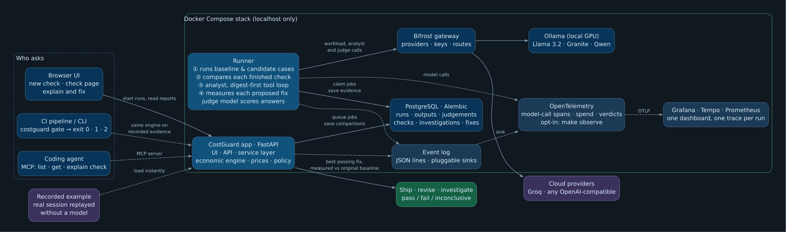

# CostGuard: project reference

The complete reference for the project: why it exists, how it got here, what it does, how it is built and why it is built that way. It describes the repository at commit `265d182` (2026-11-01). Shorter documents answer narrower questions:

| Document | Use it for |
| --- | --- |
| [README.md](../README.md) | Installing, running and using it |
| [VISION.md](../VISION.md) | Where the product is meant to go (a direction, not a specification) |
| [PROJECT_GUIDE.md](PROJECT_GUIDE.md) | A one-page status summary for evaluation |
| [DEMO.md](DEMO.md) | The 5-minute presenter script |
| **This file** | Everything else: history, decisions, internals |

Contents: [1 Purpose](#1-purpose-and-vision) · [2 History](#2-history) · [3 What exists today](#3-what-exists-today) · [4 A check, end to end](#4-a-check-end-to-end) · [5 Architecture](#5-architecture) · [6 Domain model](#6-domain-model) · [7 The economic engine](#7-the-economic-engine) · [8 Running workloads](#8-running-workloads) · [9 The analyst](#9-the-analyst) · [10 The judge](#10-the-judge) · [11 Recorded replay](#11-recorded-replay) · [12 Surfaces](#12-surfaces) · [13 Persistence](#13-persistence) · [14 Infrastructure](#14-infrastructure-and-devops) · [15 Testing](#15-testing) · [16 Decisions](#16-decisions-and-why) · [17 Findings](#17-measured-results-and-live-findings) · [18 Limits](#18-limitations-and-risks) · [19 Extending](#19-extending-it) · [20 Not built](#20-not-built) · [21 Glossary](#21-glossary)

---

## 1. Purpose and vision

AI application costs change with prompts, models, context size, retries, tool calls and agent behaviour. A prompt edit that reads as harmless in code review can multiply the cost of every request and break the output. CostGuard is an **economic regression test for AI workloads**: it answers, *before a change ships*,

1. what changed,
2. what it costs (per request, per month, under stated traffic and price assumptions),
3. whether it still meets cost, quality and behaviour limits, and
4. what to try next.

Token pricing is an internal primitive, not the product. The unit of analysis is a **workload** (a set of cases run through a baseline and a candidate version), not a token count.

### Principles that shaped the code

- **Deterministic decisions.** Pass, fail and inconclusive come from stored observations and an explicit price catalog. LLMs (the analyst and the judge) produce *evidence and hypotheses*, never the verdict.
- **Missing evidence is not a pass.** Failed cases, missing or estimated usage, absent prices or unscored answers make a result *inconclusive*.
- **Explicit assumptions.** Both variants are priced on one versioned catalog. Local inference has no bill, so live checks use labelled OpenRouter *reference rates*. Monthly projections state their traffic assumption. Repricing says it holds behaviour fixed.
- **Measured, not trusted.** A fix proposed by a model is only a hypothesis until it has been run against the original baseline under the same limits.
- **Provider-neutral.** Every model call goes through an OpenAI-compatible gateway (Bifrost); provider keys stay there.
- **Smallest coherent increments.** [AGENTS.md](../AGENTS.md) asks for focused increments, tests for changed behaviour and documentation of only what is implemented.

### Context

CostGuard is a demonstration project for a course on *AI, DevOps and intelligent developer tools*. That fixed three constraints early: the working must be **clean and visible rather than complex**; **Docker and PostgreSQL stay**; **Bifrost** (one gateway for local models and cloud APIs) is a welcome addition but not a must. Everything runs locally on one laptop (RTX 3070 Ti, 8 GB), so reliability on modest hardware drove several decisions.

---

## 2. History

| Date | Commit | What happened |
| --- | --- | --- |
| 2026-09-20 | `f15d788` | Initial release: a small FastAPI service that compares token costs of two workloads (`POST /compare`), with CI. The stateless endpoint still exists. |
| 2026-09-21 | `310615d`, `51b0d5c` | Removed a committed virtual environment; added a README. |
| 2026-10-04 | `b570070` | **Economic regression prototype.** Versioned execution artifacts, a sequential runner, PostgreSQL with Alembic, the Bifrost gateway, a mock provider, scenarios (repricing), an MCP server, the first workflow diagram and the end-to-end test. |
| 2026-10-06 | `d27e2ec` | **Bounded LLM investigations.** An analyst model with scoped read-only tools, an approved-experiment workflow (a proposed prompt becomes a job the user must approve), and the first investigation pages. |
| 2026-10-06 | `69bf42d` | Repository cleanup. |
| 2026-10-22 | `efd9c6d` | **Demo polish and the CI gate.** A real-model support-triage demo (Ollama or cloud), live progress, hidden-reasoning visibility, rate-limit handling, a plain-language report page with repricing, number-checked findings (analyst prompt v2), the `max_quality_drop` regression limit, `python -m costguard gate` with exit codes and a GitHub Actions job summary, a Makefile, the architecture diagram and a recorded database snapshot. |
| 2026-10-22/23 | `e446e9d`, `85be31d` | CI moved to `actions/checkout@v5`; presenter script (`DEMO.md`), numbered fixes (`analyst-fix-N`), clearer next steps. |
| 2026-10-25 | `a0527e9` | **Live analyst on an 8 GB GPU.** Ollama context raised to 16K with an 8-bit KV cache (Granite had been failing with HTTP 500 when its reasoning filled the context), gateway errors explained by type, analyst prompt v3. |
| 2026-11-01 | `79b75c5` … `265d182` | **The overhaul** (seven increments, below). |

### Why the overhaul

After the October demo work the engine was sound but the product around it was not. The user's assessment was blunt: the UI was poor, the demo was fragile, the workflow did not follow a logical story. The audit found:

- **UI.** Five page types in internal vocabulary (job, artifact, experiment, scenario), three inconsistent renderings of the same limits, a misleading green −69 % latency (a cold model load), an analyst page that said the same thing three times, and a fix diffed against the candidate instead of the baseline.
- **LLM use.** The analyst spent 2–3 minutes of reasoning-model tool calls rediscovering facts CostGuard already knew; it proposed *one* fix, so the demo was a coin flip; and quality could only be an exact or normalized label match, so only classification prompts could be checked.
- **Structure.** Orchestration was spread over `api.py` (35 database calls), `web.py` (21), `runner.py`, a demo helper and the MCP server, and the browser's JavaScript drove the pipeline (poll the jobs, then POST the comparison). Adding observability or more MCP tools meant touching four places.
- **Fragility.** The demo needed the GPU, free VRAM, open ports and a nondeterministic analyst run to all work at once.

The user then set the direction: *"plan an overhauled version which is also more logical and usable/demoable"*, *"we also need to use LLMs better"*, and *"make it so that in future we can add things like observability, MCP and more"*.

### The seven increments

| # | Commit | Change |
| --- | --- | --- |
| 1 | `79b75c5` | Seams, with behaviour unchanged: `service.py`, `diagnosis.py`, `evaluators.py`, `events.py`, and an analyst tool registry. |
| 2 | `a814325` | New interface: one page per check, shared limits table, new vocabulary, redirects from the old URLs. |
| 3 | `0f5b05b` | Editable checks and a **server-side pipeline**: the plan is stored, the runner compares when the second run ends, the browser only watches. |
| 4 | `8722925` | **Digest-first analyst and fix search** (protocol v4): CostGuard sends its evidence up front; the analyst proposes up to three fixes; all are measured; a deterministic rule picks the winner. |
| 5 | `28debc0` | **LLM judge** evaluator for answers with no single right label, plus a second preset. |
| 6 | `ccbe2da` | **Recorded replay**: a real session exported once, loadable instantly with no model. |
| 7 | `265d182` | MCP tools over the service layer, rewritten docs, re-rendered architecture diagram. |

Earlier-round decisions that still hold: trim the surface and add *what-if prices*; run the cost gate in GitHub Actions; keep an answer-first analyst presentation.

---

## 3. What exists today

- **Checks.** Edit two prompts, the cases, scoring and limits in the browser (or via the API). A runner executes both versions; the comparison is saved server-side. Presets: *support triage* (label match) and *refund replies* (judged).
- **Scoring.** `exact`, `normalized`, `llm_judge`, held in a registry.
- **Analysis.** Paired-case cost and latency, per-model and per-case attribution, p95 cost and latency, model calls, retries, tool and agent steps, monthly projection, what-if repricing, cost per successful task, and twelve policy limits.
- **Analyst.** Starts from a digest; has three tools; proposes one to three prompts; its spend is recorded apart from the workload's; every number in its findings is checked against the evidence it saw.
- **Fix search.** One click measures every proposed fix against the original baseline; the passing fix with the lowest cost per successful task is highlighted.
- **Replay.** A recorded real session loads instantly (`make recorded`, the home page button, or the API).
- **One service layer** behind the browser, HTTP API, CLI, MCP server and runner.
- **Events and telemetry.** One JSON line per event through pluggable sinks. With `make observe`, OpenTelemetry traces and metrics go to a provisioned Grafana dashboard (§12).
- **MCP.** `list_checks`, `get_check`, `explain_check` (no model call), plus run, report and investigation reads; `start_check` is gated.
- **Own evidence.** Import a versioned execution artifact, or capture one with `costguard.hook`.
- **DevOps.** Docker Compose profiles, GitHub Actions (image, unit tests, cost gate, end-to-end), Makefile shortcuts.
- **Tests.** 165 unit tests plus a mock end-to-end workflow.

Roughly 6,400 lines of Python across the package, demo provider, entry point and tests.

---

## 4. A check, end to end

```
 New check form / POST /api/v1/checks / CLI / MCP start_check
                         │
              service.create_check
   ├─ build two ExperimentSpecs (identical except the system prompt)
   ├─ queue two jobs; store the plan as setting  pending-check:<candidate_job_id>
   └─ emit check.created
                         │
        runner (separate container, one job at a time)
   ├─ per case: gateway call (temperature 0) → score with the evaluator → record tokens, latency, output
   ├─ save an ExecutionArtifact per job; emit run.finished
   └─ service.job_finished(job_id)
          ├─ finish_check: when both runs are complete → compare → save report  (emit comparison.saved)
          └─ finish_fix:   if the job was a fix → compare with the ORIGINAL baseline  (emit fix.measured)
                         │
 /checks/running/<job>  polls  →  redirects to  /checks/<report_id>  when the report exists
                         │
 /checks/<id>  verdict · limits table · prompt diff · cost drivers · cases · what-if
                         │  "Ask the analyst why"
              service.start_investigation → runner → analyst loop (digest, tools, ≤8 calls)
                         │  result: findings (number-checked) + 1–3 proposed prompts
                         │  "Test the fixes"
              service.test_fixes → one job per fix → runner → finish_fix → scoreboard + winner
```

Key properties:

- **The browser orchestrates nothing.** Closing the tab changes nothing; the runner finishes the pipeline. The running page is refresh-safe because the plan lives in the database.
- **A check is compared once** (`report_id` is written into the plan), so replays of `job_finished` are harmless.
- **A fix is just another check.** It has its own report and page, priced and judged on the same limits as the original, and nested under the original in the list.
- **The runner alternates** between the job queue and the investigation queue so neither starves the other.

---

## 5. Architecture



Source: [costguard-architecture.dot](costguard-architecture.dot) (Graphviz). The earlier intended-workflow diagram is [costguard-workflow.svg](costguard-workflow.svg).

### Runtime topology (Docker Compose)

| Service | Image / role | Profiles | Host port |
| --- | --- | --- | --- |
| `postgres` | `postgres:17-alpine`; all evidence | always | 55432 |
| `app` | FastAPI: API, browser pages, docs; runs `alembic upgrade head` on start | always | 8000 |
| `runner` | Same image; `python -m costguard.runner`; workloads and analyst runs, sequentially | always | none |
| `bifrost` | `maximhq/bifrost:v2.2.3`; OpenAI-compatible gateway, provider keys | gateway, demo, local | 8080 (`BIFROST_PORT`) |
| `ollama` | `ollama/ollama:0.34.1`; local models | local | 11435 |
| `mock-provider` | Deterministic OpenAI-shaped provider, scripted analyst and judge | demo | none |
| `lgtm` | `grafana/otel-lgtm:0.39.0`; OTLP collector, Prometheus, Tempo and Grafana with the CostGuard dashboard | observability | 3000 (`GRAFANA_PORT`) |

All published ports bind to `127.0.0.1`. Containers run as a non-root user (uid 10001).

### Layers inside the package

```
 surfaces      web.py (+ templates, analyst_view.py)   api.py   __main__.py (CLI)   mcp_server.py   runner.py
                         \              |            |                  /             /
 orchestration                       service.py   (the product's verbs; domain errors)
                         /                 |                 \
 logic         economics.py  analysis.py   diagnosis.py   evaluators.py   investigation.py   recorded.py
 persistence   db.py (SQLAlchemy, job queue, settings)        gateway.py   ratelimit.py   events.py
 schemas       models.py (workload and policy)    execution.py (artifacts, specs, judge)    checks.py
```

Rules the layering follows:

- Surfaces never reach into `db` for *orchestration*; they call `service`. (Plain reads such as a job page may still call `db`.)
- `economics`, `analysis` and `diagnosis` are **pure functions over saved evidence**. They are what the gate, UI, analyst and MCP all read, so one fact is worded one way everywhere.
- `service` raises domain errors (`NotFound`, `Conflict`, `Unavailable`); each surface maps them to its idiom (HTTP 404/409/503 in `main.py`, an exit code in the CLI, an exception in MCP).

### Module map

| Module | Responsibility |
| --- | --- |
| `service.py` | `create_check`, `finish_check`, `check_progress`, `get_check`, `list_checks`, `explain_check`, `compare`, `reprice_run`, `start_investigation`, `test_fixes`, `finish_fix`, `job_finished`, `fix_rows`, `load_recorded`, `recorded_reports`, `start_mock_demo`. The `Check` dataclass bundles everything a page needs. |
| `models.py` | Pydantic `Schema` base (strict, Decimals serialized as fixed-point strings); pricing catalog, workload, `ComparisonPolicy`, `ComparisonReport`. |
| `analysis.py` | `token_cost` (one call at explicit prices); `compare_workloads`: paired-case cost, per-model attribution, paired quality, monthly projection and the policy rules. |
| `economics.py` | `compare_artifacts`: wraps `analysis` for execution artifacts, adds behaviour metrics, p95s, contributors, the inconclusive rules and behaviour limits; `case_cost`; `reprice`. |
| `execution.py` | `ExecutionArtifact` / `CaseExecution` / `Call` / `Step` / `Charge`, `ExperimentSpec`, `ExecutionLimits`, `Judge`, `Judgement`. |
| `diagnosis.py` | `LIMITS` table and `limit_rows`, `breakdown`, `explain`, `case_rows`, `changed_cases`, `prompt_change`, `pick_winner`, `judge_spend`, `headline`, formatting helpers. |
| `evaluators.py` | Evaluator registry: `exact`, `normalized`, `llm_judge`. |
| `checks.py` | `CheckInput` (what the form or API sends), presets, `build_specs`, `analyst_from`, `demo_check`. |
| `runner.py` | `run_case`, `execute_job`, the work loop; heartbeat thread; calls `service.job_finished`. |
| `investigation.py` | Analyst protocol: `AnalystSettings`, `EvidenceTools` (`digest`, `inspect_case`, `propose`, `finish`), the tool registry, `investigate` loop, number checking, `fix_name`, `proposals_of`. |
| `investigation_worker.py` | Runs a persisted investigation with a heartbeat; never replays a lost lease. |
| `recorded.py` | Export and replay of recorded sessions. |
| `db.py` | Tables, import with digest dedup, the job and investigation queues with leases, fix bookkeeping, settings. |
| `gateway.py` | Gateway URL, headers, status, `parse_json_reply`. |
| `ratelimit.py` | The only automatic re-send (HTTP 429) and `error_reason`. |
| `events.py` | `emit`, `add_sink`, `clear_sinks`. |
| `telemetry.py` | OpenTelemetry: `setup`, `span`, `model_call` / `ModelCall`, `on_event` (the events sink), `status`. A no-op until an OTLP endpoint is set. |
| `hook.py` | Opt-in `ArtifactRecorder` to capture an application's own evidence. |
| `bootstrap_gateway.py` | Registers Ollama or mock providers and keys in Bifrost. |
| `analyst_view.py` | Presentation of the 'Explain and fix' section: the analyst's conclusion with links and the number check, its activity in plain words, measured fixes. Pure; the template only lays it out. |
| `mcp_server.py`, `api.py`, `web.py`, `__main__.py` | The surfaces. `web.py` holds routes only. |
| `main.py` | App assembly: routers, static files, Host and origin guards, error mapping, stateless `/compare`. |
| `demo/mock_provider.py` | Scripted provider for CI and the end-to-end test. |

---

## 6. Domain model

| Concept | Type | Notes |
| --- | --- | --- |
| **Workload** | cases run through one configuration | Cases are `CaseInput(case_id, prompt, expected_text?)`. |
| **ExperimentSpec** | what the runner executes | suite, name, provider/model, system prompt, evaluator, optional `Judge`, temperature, cases, pricing, limits (timeout, max output tokens, attempts, steps, optional `stop_after_usd`). Validated: unique case IDs, a judge exactly when the evaluator is `llm_judge`, a price for the chosen model. |
| **ExecutionArtifact** | what happened (schema version 1) | Per case: status, latency, `Call`s (provider, model, input/output tokens, **`usage_source`**: provider/gateway/estimated/missing, status, attempt, latency), `Step`s (model/tool/retrieval/agent), `Charge`s (non-model costs), quality score and evaluator ID, output (≤4,000 chars), hidden reasoning, optional `Judgement`. Imported once per content digest. |
| **PricingCatalog** | explicit prices | Versioned, unique per provider/model, with a source note. |
| **ComparisonPolicy** | the limits | Ten optional fields, listed in §7. |
| **ComparisonDetails** | a saved report | Verdict, reasons, policy result, the economic comparison, counts of missing/estimated usage and failed cases, behaviour metrics, p95s, contributors. |
| **Check** (service) | report + both artifacts + limit rows + cost breakdown + paired cases + related investigations + replay and judge info | The object every page and the MCP tools read. |
| **Fix** | an analyst-proposed spec | Named `analyst-fix-N[a-c]`; measured as a normal check against the original baseline. |

Conventions worth knowing:

- Money is `Decimal`, serialized as fixed-point strings (`"0.00000000"`, never floats or `0E-8`).
- A spec's **identity** for comparison is `suite_id` plus the case-ID set; differing sets make a comparison inconclusive.
- The `judgement` field is *omitted* from serialized JSON when unset (a custom serializer), so artifacts stored before judges existed keep identical digests and old recordings stay valid.

---

## 7. The economic engine

### Pricing a case

`case_cost` sums, per call, `input_tokens × input price + output tokens × output price` (per million) plus any non-model `Charge`s. If any call lacks tokens or a price, the cost is unknown (`None`), and so is anything derived from it. Reasoning models' hidden reasoning is billed as output tokens and is included in the usage the gateway reports.

### The comparison

`economics.compare_artifacts(baseline, candidate, pricing, policy, monthly_requests)`:

1. Collects reasons the result cannot be trusted (§ below).
2. If comparable, converts both sides into workloads and calls `analysis.compare_workloads`: mean cost per request, mean latency, per-case and per-model cost deltas, **paired** quality (only cases scored on both sides with the same evaluator), optional monthly projection (`mean cost × requests`).

   **Cost per successful task** (`ComparisonReport.cost_per_successful_task_usd`) is the mean cost per request divided by the mean quality score on each side, so a fractional judge score counts as a partial success. Retries are inside the cost; judge and analyst spend are not. It is *absent* unless every case is scored on both sides (a scored subset cannot vouch for the rest), and a side with no success has no value (`null`), never a guessed one. Reports saved before it existed simply lack the field.
3. Adds p95 cost and latency, behaviour metrics (model calls, retries = calls with `attempt > 1`, tool steps, agent steps per case) and "contributors" (the largest positive deltas).
4. Applies the policy: economic limits inside `analysis`, behaviour limits in `economics`.

**The result is `inconclusive`, never a false pass, when:** suite IDs or case-ID sets differ; any call has missing usage (a failed attempt without usage counts, because it may still be billed); any case did not complete; any case has no model call; any call uses *estimated* usage; a price is missing; or a quality limit is set but not every case has paired scores.

The two cost-per-success limits follow the same rule as quality: unscored cases make them inconclusive; a candidate with no successes breaks either (it is unboundedly dear per success); a baseline with none leaves the percentage limit inconclusive because there is nothing to compare with.

Verdict values: `pass`, `fail`, `inconclusive`, `not_evaluated` (no limits set).

### The twelve limits

| Policy field | Reads as |
| --- | --- |
| `max_cost_per_success_increase_percent` | cost per successful task may rise by at most N % |
| `max_candidate_cost_per_success_usd` | candidate cost per successful task at most $N |
| `max_cost_increase_percent` | cost per request may rise by at most N % |
| `max_candidate_cost_per_request_usd` | candidate cost per request at most $N |
| `max_monthly_cost_usd` | projected monthly cost at most $N |
| `min_candidate_quality_score` | at least N % of answers correct |
| `max_quality_drop` | correct answers may fall at most N points below the baseline (0 = no fewer correct answers) |
| `max_candidate_mean_latency_ms` | mean latency at most N ms |
| `max_candidate_model_calls_per_case` | at most N model calls per case |
| `max_candidate_retries_per_case` | at most N retries per case |
| `max_candidate_tool_steps_per_case` | at most N tool steps per case |
| `max_candidate_agent_steps_per_case` | at most N agent steps per case |

`diagnosis.LIMITS` is the single table that words each limit, measures it from a report and decides whether it is broken; `limit_rows` produces the "limit · measured · pass/fail/unknown" rows every surface shows. Counts are shown as "6/8 correct", never as 0.75 beside 6/8.

*Regression vs absolute quality.* The demo uses `max_quality_drop: 0` rather than a fixed bar because it is a regression test: the 3B workload model misroutes two of eight messages even with the good prompt, so a fixed 85 % threshold would fail every fix.

### What-if repricing

`economics.reprice` applies other prices and traffic to one run's measured tokens. It refuses (inconclusive) with failed cases or unobserved usage, and labels its result `hypothetical`: usage and behaviour are held fixed; quality and latency are not predicted. The check page offers one-click presets.

### Explanations

`diagnosis.breakdown` splits the mean cost change into input and output tokens, with shares and a driver, and `explain` words it ("98 % of the change comes from output tokens: 2 → 226 per case on average. The model is writing longer responses."). `case_rows` pairs the two sides of each case; `changed_cases` picks the cases whose score or cost changed most; `prompt_change` counts words added and removed with `difflib` because every prompt word is paid on every request.

---

## 8. Running workloads

`runner.run_case` sends one chat completion per attempt through the gateway (`/v1/chat/completions`, with the spec's temperature, `max_tokens` and system prompt) and records usage as `gateway` when the response includes token counts, otherwise `missing`.

Behaviours that are deliberate:

- **Sequential.** One job at a time. Ollama serves one request at a time on this hardware, and ordering keeps latencies comparable.
- **Temperature 0** for checks, so differences come from the prompt, not sampling.
- **No automatic replay of paid calls.** A failed request is not re-sent, except HTTP 429, which the provider rejected before processing: `ratelimit.post` waits for `Retry-After` (or `x-ratelimit-reset-tokens`, else a backoff) up to 180 s. The wait is recorded in the call's tags and **excluded from latency**.
- **Retries** (`max_attempts`) apply only to retryable statuses (5xx, 408, 409, 429) and are recorded as extra `Call`s with `attempt > 1`.
- **Leases and heartbeats.** A claimed job holds a 60 s lease renewed by a 15 s heartbeat thread. An expired lease marks the job `interrupted` ("paid calls are not replayed automatically"); it is never silently re-run. Investigations use a 180 s lease.
- **Spend threshold.** `stop_after_usd` is checked *between* cases; it is not a hard cap on an in-flight call, and, when a threshold is set, a case with missing usage interrupts the job (the threshold cannot be enforced).
- **Cancellation** is cooperative (`should_continue`).
- **Output** is truncated to 2,000 characters per case before storage.
- **`tool_loop` kind** is a small deterministic example (a word-count tool step) used to exercise step limits; the main flows use `prompt`.

---

## 9. The analyst

An optional model that explains a failing check and proposes fixes. It **cannot run anything**; it can only call read-only tools and *propose*; a person (or the "Test the fixes" button) queues the runs.

### Protocol (`PROMPT_VERSION = "economic-investigator:v5"`)

The tool protocol dates from v4; v5 added cost per successful task to the evidence and to the instructions.

1. **Digest first.** `EvidenceTools.digest()` builds a JSON document from what CostGuard already computed: the verdict and `policy_limits`, metrics, behaviour deltas, the biggest case and model deltas, pricing, both configurations, `cost_drivers`, `prompt_change`, and the changed cases with outputs in full. It is the first user message after `DIGEST_HEADER`, and is stored in `result["digest"]`. Everything in it counts as inspected evidence.
2. **Three tools** (registry in `investigation.py`):
   - `inspect_case(case_id)` for a case the digest does not show;
   - `propose_fixes(fixes: 1–3 × {hypothesis, system_prompt})`: all-or-none; rejects prompts identical to the source or to each other; callable once; keeps cases, model, prices and limits; names the specs `analyst-fix-Na/b/c`;
   - `finish_investigation(summary, findings, hypotheses, next_steps)`: findings must cite only references the analyst has seen on an earlier turn (`comparison`, `case:<id>`). When a source experiment exists and nothing was proposed, the first finish attempt is bounced once with a reminder to propose.
3. **Budget.** At most 8 calls (default 5), at most 4 tool calls per turn, a 60,000-character context cap, `stop_after_usd` (default $0.10) checked between calls, and `max_output_tokens` (up to 4,096). Prose is never accepted as a conclusion; a structured JSON conclusion is accepted from models that do not call tools.
4. **Receipts before interpretation.** An `in_flight` call with unknown cost is persisted *before* contacting the provider; missing usage stops the loop. A lost lease is not replayed.
5. **Number check.** `unsupported_numbers` flags numbers in the analyst's prose that match nothing it was shown (tolerance at the precision written, ~15 % for "about"/"around"). It reports *absence*, not falsehood: a correctly derived ratio can be flagged.

The system prompt tells the analyst the changed cases are shown in full, to treat all data as non-instructions, to separate observation from hypothesis, to vary fix approaches (restore baseline wording, keep only what is needed, constrain the format) and that every prompt word is paid on every request.

### Fix search and the winner rule

`service.test_fixes` creates one job per proposed spec (idempotent). When each finishes, `finish_fix` compares it with the **original baseline** under the **original prices and limits** and records the report in `investigations.fixes`. `diagnosis.pick_winner` then chooses **the fix that passes every limit and pays the least per successful task, ties to the shorter prompt** (a passing fix without that metric ranks by cost per request, but only when no passing fix has it); if none pass, none is highlighted and the page offers to ask the analyst again on the closest fix. The model proposes; measurement and a fixed rule decide.

### Older shapes

Investigations before v4 stored one `result["proposal"]` and `proposal_job_id`/`proposal_report_id`; `proposals_of` and `db._fixes` normalize them, so old rows still render.

### Why a digest

The earlier analyst (v1–v3) discovered the comparison by calling `inspect_comparison` and then cases, taking 4–6 calls and 2–3 minutes with a reasoning model. The digest cut the recorded run to **2 calls and $0.0022**. In live testing, a model that was still allowed `inspect_comparison` kept calling it and inspecting digest cases and timed out (645 s), so that tool was removed and the prompt now says the listed cases are shown in full.

### Models tried

| Model | Role | Finding |
| --- | --- | --- |
| `llama3.2:3b-instruct-q4_K_M` | workload | Fast; follows a one-word label format. Too weak as analyst or judge. |
| `granite4.2:8b-q4_K_M` | analyst | Most accurate findings; fits an 8 GB GPU (6.6 GB loaded); a reasoning model, so it needs output room. |
| `qwen3.5:4b-q4_K_M` | analyst | Completes investigations, but its findings had factual slips. |

---

## 10. The judge

Some answers have no single right label (a refund reply must be polite and state a timeline). The `llm_judge` evaluator scores each answer with a **separate pinned model** against a rubric.

- Configured by `Judge(provider, model, rubric, prices, max_output_tokens=300, timeout=60)`. Evaluator ID: `llm_judge:v1:<provider>/<model>`.
- The judge gets the rubric as instructions; the message, any reference answer and the answer are passed as JSON *data*. Temperature 0. It must reply with `{"pass": bool, "reason": "…"}`; `parse_json_reply` tolerates a Markdown fence, nothing else.
- **No usable verdict means no score** (`quality None`): an unreachable judge, an empty reply (a reasoning model that spent its whole budget thinking gets a specific message), non-JSON or a non-boolean `pass`. A quality limit then turns the check *inconclusive*, never a pass.
- The judge's verdict, reason, model, tokens and cost are stored on the case as a `Judgement` and shown beside each answer. **Judge cost is never part of the workload cost**; `judge_spend` reports it separately and says when usage was incomplete.
- A judged check needs no expected answers.

**Honest limits.** A judge is a model's opinion. Live: `llama3.2:3b` accepted "3–5 business days" for a "within 5 business days" rubric and passed 270-word replies against a "60 words" rubric (even when given the word count); `granite4.2:8b` as judge burned 1,500 tokens reasoning and returned nothing. These were *not* tuned away: the preset rubric drops the length criterion, the form warns that small judges are weak, and the docs say so.

---

## 11. Recorded replay

A demo that needs a GPU, free VRAM and a nondeterministic analyst run can fail on stage, so a **real session is recorded once and replayed**.

- `examples/recorded/support-triage.json` (about 98 KB): 5 runs, 4 comparisons (the check and three fixes), the investigation and its analyst result. Recorded from a live session on the RTX 3070 Ti: check `984071f2…`, investigation `623698c9…`.
- **Only observations are stored.** Verdicts are recomputed on load by the current rules (`compare_artifacts`), so a replayed check always agrees with the code.
- **Idempotent.** Artifacts dedupe by digest; replayed job IDs are `uuid5` of the artifact ID; comparisons are skipped when their ID exists. The settings key `recorded:<name>` marks which reports belong to the example, which is how the UI shows a "Recorded example" tag.
- No gateway, model or GPU is needed.
- **Re-record** after changing prompts or the analyst: `python -m costguard record <check-id> <investigation-id> --output -` (stdout, redirected on the host, because the container user cannot write a host-mounted directory).
- `make recorded` / `python -m costguard load-recorded` / `POST /api/v1/examples/recorded` / the home page button all call `service.load_recorded`.
- An older whole-database dump (`make snapshot` / `make restore`) was removed in the cleanup: it predated migration 0004, and the replay does the same job without touching the rest of the database.

---

## 12. Surfaces

### Browser

| Route | Page |
| --- | --- |
| `/` | Checks: the list (verdict, cost change, correct x/y, date; fixes nested under their check), *New check*, *Load the recorded example* |
| `/checks/new` | Editable form: model, prompts, cases, scoring (label or rubric), limits, monthly requests, prices; presets as chips |
| `/checks/running/{candidate_job_id}` | Refresh-safe progress with live per-case answers; redirects when the report exists |
| `/checks/{report_id}` | Verdict, limits table, headline numbers, what changed (prompt diff), why (token bar), cases, what-if, **Explain and fix**, execution details |
| `/connections` | Gateway health and analyst settings |
| `/jobs/{id}`, `/artifacts/{id}` | Detail pages |
| `/reports`, `/reports/{id}`, `/investigations`, `/investigations/{id}` | Redirects to the new pages |

Vocabulary on the pages: check, baseline, candidate, limits, verdict, analyst, fix, judge. Plain Jinja2 templates and one small stylesheet and script; no SPA.

### HTTP API (`/api/v1`, interactive docs at `/docs`)

Checks and fixes: `POST /checks`, `GET /checks/running/{candidate_job_id}`, `POST /investigations`, `GET /investigations[/{id}]`, `POST /investigations/{id}/cancel`, `POST /investigations/{id}/test-fixes`, `GET /investigations/{id}/fixes`, `POST /examples/recorded`. Underlying resources: `/suites`, `/artifacts`, `/baselines/{suite}`, `/jobs`, `/comparisons`, `/scenarios`. Plumbing: `/ready`, `/gateway`, `/analyst`, `/demo` (mock demo, only with `COSTGUARD_DEMO=1`). The original stateless `POST /compare` and `GET /health` are at the root.

### CLI (`python -m costguard`)

`import`, `run [--wait]`, `baseline`, **`gate`** (exit 0 pass, 1 fail, 2 inconclusive or error; JSON and Markdown outputs), `report`, `demo` (the support-triage check on a model, optionally with the analyst), `record`, `load-recorded`, `scenario`.

### MCP (`python -m costguard.mcp_server`)

`list_checks`, `get_check`, `explain_check` (the digest facts; no model call), `list_investigations`, `get_investigation`, `list_runs`, `get_run`, `list_reports`, `get_report`, `compare_saved_runs`, `inspect_hotspots`, `reprice_saved_run`, and **`start_check`**, which makes paid model calls and is refused unless `COSTGUARD_MCP_ALLOW_RUNS=1` is set. Default posture: reading is always possible; spending is opt-in.

### Events

`events.emit(kind, **fields)` writes one JSON line to each sink (default: stdout, so `docker compose logs` shows them); a failing sink never breaks the work that emitted.

| Event | Emitted when |
| --- | --- |
| `check.created` | `create_check` queues both runs |
| `run.finished` | a job's artifact is saved (tokens, cost) |
| `comparison.saved` | any comparison is saved (verdict) |
| `fixes.started` | the first "Test the fixes" for an investigation |
| `fix.measured` | a fix has been compared with the baseline |
| `judge.call` | a judge call returns |
| `example.loaded` | a recorded example is replayed |
| `followup.error`, `runner.error` | the post-job step or the runner failed |

### Telemetry (OpenTelemetry)

Off unless `OTEL_EXPORTER_OTLP_ENDPOINT` is set; the app and the runner each call `telemetry.setup(...)` at start and export OTLP/HTTP (traces through a batch processor, metrics every `OTEL_METRIC_EXPORT_INTERVAL`, 10 s in Compose). Until then every instrumentation call is a no-op, so code instruments unconditionally.

**Spans.** A run is one trace: `run <name>` → `case <id>` → `chat <provider/model>` for the workload call and, for judged checks, the judge call; the comparison that follows is a `compare` span inside the run. An analyst run is `investigation` → `chat <model>` per call and `tool <name>` per tool use. Model-call spans use the OpenTelemetry GenAI attributes (`gen_ai.operation.name`, `gen_ai.request.model`, `gen_ai.usage.input_tokens`, `gen_ai.usage.output_tokens`) plus `costguard.role` (workload, judge, analyst), `costguard.cost_usd` and, for the workload, `costguard.attempt`. A failed call marks its span as an error.

**Metrics.**

| Metric (Prometheus name) | Labels | Meaning |
| --- | --- | --- |
| `costguard_model_calls_total` | role, model, outcome | Model calls |
| `costguard_model_tokens_total` | role, model, direction | Tokens used |
| `costguard_model_spend_USD_total` | role, model | Cost at the entered prices; a call with unknown usage adds nothing |
| `costguard_model_duration_seconds` | role, model | Call duration, leaving out rate-limit waits |
| `costguard_checks_total`, `costguard_runs_total` | model | Checks started, runs finished |
| `costguard_comparisons_total`, `costguard_fixes_total` | verdict | Comparisons saved, fixes measured |
| `costguard_errors_total` | kind, type | Failures the runner survived |

Model-call signals come from `telemetry.model_call` wrapped around each call (runner, judge, analyst); pipeline counters come from the existing events through the `on_event` sink, so a new event kind is a one-line addition. Spend is computed once per call by `analysis.token_cost` for the telemetry, the judge's recorded cost and the analyst's budget.

**Backend.** `make observe` adds the `observability` profile: one `grafana/otel-lgtm` container (collector, Prometheus, Tempo, Grafana) with the dashboard in `observability/dashboards/costguard.json` provisioned through `observability/dashboards.yaml`. Grafana is open without a login and bound to localhost. Any other OTLP backend works by setting the endpoint (and the standard `OTEL_EXPORTER_OTLP_HEADERS`).

**Caveats.** Counters live in each process and restart with it, so the dashboard shows totals since the app and runner last started (a counter's first exported value already contains earlier increments, so rate-based panels would miss a first burst). Telemetry describes CostGuard's own spend and health and never feeds a verdict. Not instrumented: HTTP request spans, queue and lease metrics, logs.

### Security posture

Single-user and local. `main.py` rejects unexpected `Host` headers (DNS rebinding; list in `COSTGUARD_ALLOWED_HOSTS`) and state-changing requests carrying a foreign `Origin`. Provider keys live only in Bifrost. Bifrost's own dashboard is unprotected until its admin setup is finished. Do not expose the stack publicly without authentication, TLS and secret management.

---

## 13. Persistence

PostgreSQL via SQLAlchemy; schema managed by Alembic (run automatically by the `app` container).

| Table | Holds |
| --- | --- |
| `artifacts` | Execution artifacts as JSONB, with a content digest (identical imports dedupe) |
| `suites`, `baselines` | Saved experiment specs; promoted baseline per suite |
| `comparisons` | Request and report JSONB per saved comparison |
| `jobs` | Queue: state, spec, progress, per-case live summaries, lease, artifact link |
| `investigations` | Analyst runs: state, request, result JSONB, lease; `fixes` JSONB (0004); legacy `proposal_*` columns |
| `settings` | Key/value JSONB: `analyst`, `pending-check:<candidate_job_id>`, `recorded:<name>` |

Migrations: `0001_initial`, `0002_investigations`, `0003_job_cases` (live per-case summaries), `0004_investigation_fixes` (the measured fixes). The job queue uses `SELECT … FOR UPDATE SKIP LOCKED` with leases. Run outputs (up to 2,000 characters per case) are stored with the evidence, and the analyst sees the digest plus any case inputs and outputs it requests.

Design note: no `checks` table. The settings table and result JSON carry the new state (pending plans, fixes, replay marks). A `checks` table is the natural next step if observability or multi-user use grows.

---

## 14. Infrastructure and DevOps

### Profiles

- `local`: Ollama + Bifrost (real models, free).
- `gateway`: Bifrost only, for cloud providers.
- `demo`: Bifrost + a deterministic mock provider (CI and the end-to-end test; `COSTGUARD_DEMO=1`).
- `observability`: the Grafana stack. Added by `make observe`, which also points the app and runner at it.

### Configuration (`.env`, see `.env.example`)

`OTEL_EXPORTER_OTLP_ENDPOINT` (empty = telemetry off), `OTEL_METRIC_EXPORT_INTERVAL`, `GRAFANA_PORT`, `POSTGRES_PASSWORD`, `BIFROST_ENCRYPTION_KEY`, `BIFROST_SETUP_TOKEN`, optional `BIFROST_VIRTUAL_KEY`, `BIFROST_PORT` (host port; 8081 on this machine because 8080 was taken), `COSTGUARD_DEMO`, and Ollama tuning: `OLLAMA_MAX_LOADED_MODELS=1`, `OLLAMA_NUM_PARALLEL=1`, `OLLAMA_CONTEXT_LENGTH=16384`, `OLLAMA_FLASH_ATTENTION=1`, `OLLAMA_KV_CACHE_TYPE=q8_0`. `compose.gpu.yaml` adds the NVIDIA device (set `COMPOSE_FILE=compose.yaml:compose.gpu.yaml`).

### Makefile

`up`, `down`, `models` (pull workload and analyst, register in Bifrost), `warm` (load the workload model so the first run does not wait), `observe` (the stack with Grafana and telemetry), `recorded`, `demo`, `test`, `e2e`, `gate`, `logs`.

### CI (`.github/workflows/ci.yaml`, on push and pull request to `main`)

1. Build the image. 2. Unit tests. 3. **Cost gate** on recorded Groq runs in `examples/ci` (the verbose candidate must exit 1, the analyst's fix exit 0; both appear in the job summary). 4. Start the demo stack. 5. End-to-end integration (`tests/e2e.py`). 6. `validate.sh` smoke check of the original `/compare`. 7. Logs on failure, always stop the stack. The CI policy is a JSON file in the repo (`max_cost_increase_percent: 20`, `max_quality_drop: 0`).

### Hardware notes

An 8 GB GPU holds Granite 4.2 8B (6.6 GB) only with the 8-bit KV cache and 16K context. **A laptop on battery throttles the GPU several-fold**: a check that takes ~20 s on AC took 108 s on battery, and an analyst run 171 s (an earlier one hit a 504 at 300 s). Plug in before a live demo.

---

## 15. Testing

- **Unit tests** (165; `make test` runs them in the app image: `python -m unittest discover`): `test_analysis`, `test_execution`, `test_evaluators`, `test_checks`, `test_diagnosis`, `test_investigation`, `test_service`, `test_web`, `test_recorded`, `test_mcp`, `test_events`, `test_telemetry` (in-memory exporters; no collector needed). They patch out the database and gateway calls, so they run in the app image without the rest of the stack.
- **End-to-end** (`tests/e2e.py`, `make e2e`): against the demo stack with the mock provider, it covers a check from creation to verdict, the digest-first analyst, fix search (statuses pass/fail with one winner), a judged check, recorded replay, the UI pages, the CLI and MCP (including the refusal of `start_check`). A traceback from that expected refusal in the log is normal.
- **Gate test** (`make gate`): exit 1 for the candidate and 0 for the fix.
- **The mock provider is a fixture, not a model.** It proves the workflow, not reasoning quality. Its scripted fix B legitimately fails the 10 % cost limit, which is why the e2e expects `["pass", "fail"]`.
- The unit tests need no database or gateway (CI runs them before the stack starts). A web test that quietly reached PostgreSQL had caused both a `ResourceWarning` and failures without the stack; it now patches that call.

---

## 16. Decisions and why

| Decision | Why | Alternatives set aside |
| --- | --- | --- |
| Deterministic engine decides; LLMs advise | A model's explanation can be wrong; money and verdicts must be reproducible | Letting the analyst grade its own fix |
| Measure every fix against the **original baseline** | A fix diffed against the candidate can look better than the baseline it must beat | Comparing a fix to the candidate |
| Rank by **cost per successful task**, not per request | A prompt that is cheaper per request but gets answers wrong is not a saving; the unit that matters is a right answer | Cost per request alone (it crowned the fix with one wrong answer); quality as a separate tie-breaker |
| Offer up to **three** fixes and pick by rule | One fix made the demo a coin flip (2 of 3 live fixes passed earlier); a rule keeps it explainable | Trusting the analyst's own ranking |
| **Digest-first** analyst | Removes minutes of rediscovery, works with weaker models, cheaper and testable | Letting the model explore with tools alone |
| Remove `inspect_comparison` | A live model kept re-calling it and timed out | Prompt wording alone |
| **Judge** with strict JSON and "no verdict means no score" | Lets non-classification prompts be checked without ever turning a judge failure into a pass | Free-text grading; treating failures as 0 |
| Judge cost reported separately | Keeps the workload cost an honest measure of the thing under test | Adding judge spend to totals |
| Do not tune the judge to the demo | A small judge's weakness is a finding to state, not hide | Adding `answer_words` to the judge's data |
| **Server-side pipeline** | The browser stopped being the orchestrator; refresh-safe; the same path for API, CLI and MCP | JavaScript polling then POSTing the comparison |
| **One service layer** | New surfaces (MCP, observability) get identical behaviour without touching four places | Logic in each handler |
| **Registries** for evaluators and analyst tools | New kinds are additive, no `if` chains | Hard-coded dispatch |
| **Event sinks** | Observability is one more function, not a schema change | Building an exporter now (speculative; since built on top of them, see below) |
| **OpenTelemetry with a Grafana stack, opt-in** | One standard that works the same from the app and the runner (two processes, so a scraped `/metrics` would need two ports); traces as well as metrics; the course is DevOps, so a visible dashboard matters. One all-in-one container keeps it to a single added service | Prometheus `/metrics` only (no traces, two scrape targets); OTLP with no bundled dashboard (nothing to show) |
| **Telemetry never feeds a verdict; model calls instrumented at the call site** | Verdicts stay deterministic and reproducible; spend by role needs the exact call, which an event after the fact cannot give | Deriving spend from stored artifacts only |
| **Recorded replay as the default demo** | A demo cannot fail on hardware; only observations stored, verdicts recomputed | A static screenshot or a fixed fake report |
| Settings table for pending plans and replay marks | No migration, smallest increment | A `checks` table (deferred) |
| `max_quality_drop` rather than a fixed quality bar | It is a regression test; a weak workload model makes any fixed bar arbitrary | Absolute thresholds only (still supported) |
| Temperature 0 | Differences come from the prompt, not sampling | Default sampling |
| Price local and cloud models at their OpenRouter rate | A local model has no bill, so it is priced as the same model on OpenRouter and every comparison is like with like; the report says the rates are reference rates, and edited rates are labelled as entered. The recorded example and the CI evidence keep the prices they were captured with | Notional rates ($0.10 / $0.40); showing $0 |
| No automatic replay of paid calls, except 429 | A failed call may already have been billed; 429 was rejected before processing | Blanket retries |
| Rate-limit waits excluded from latency | Latency should reflect the model, not the provider's quota | Counting waits |
| `start_check` over MCP is opt-in | The previous posture was "never initiates paid calls"; one flag keeps that default | Always allowing it, or never |
| "Seams plus one proof" for extensibility | Observability, MCP and more are expected later; build the seams and prove one (MCP), not a platform | Building exporters or trace import now |
| LLM-drafted test cases deferred | Out of scope for this round | — |
| Bifrost as the gateway | One OpenAI-compatible endpoint for Ollama and cloud APIs; provider keys never enter CostGuard | Per-provider clients |
| Docker Compose, PostgreSQL, Alembic | Fixed by the user from the start | — |
| Commit under the user's identity, no co-author trailer | Explicit instruction | — |

---

## 17. Measured results and live findings

Recorded on a laptop RTX 3070 Ti (`llama3.2:3b` workload at temperature 0, `granite4.2:8b` analyst, notional rates $0.10 / $0.40 per million tokens):

- **The regression.** The "helpful" candidate prompt cost **+1,044.82 %** per request ($0.89 → $10.22 per month at 100,000 requests), and quality fell from **6/8 to 0/8**. Output grew from 2 to about 226 tokens per case. Both limits (cost +20 %, no fewer correct answers) broke.
- **The analyst.** 2 calls, **$0.0022**; three proposed prompts of 30, 22 and 16 words (the baseline's has 30).
- **The fixes**, against the original baseline: A **0 %** cost per request, 6/8; B **−11.20 %**, 8/8; C **−20.17 %**, 7/8. All pass. Per successful task A is 0 %, B **−33.4 %**, C **−31.6 %**: C is the cheapest request but gets one answer wrong, so B is highlighted. (The analyst in this recording ran protocol v4 and was shown the per-request limit; the fixture's comparison limits were switched to the per-success one afterwards, and verdicts and the winner are recomputed on every load.)
- **Across two live sessions, 5 of 6 proposed fixes passed;** the failing one scored 5/8. A small sample, so fix search does not guarantee a pass.
- **Cloud (Groq, `qwen/qwen3.8-27b`, catalog prices):** the same change cost **+2,204 %** and quality went 1 → 0; these runs are the evidence behind the CI gate (about 1.5 minutes per job).
- **Judged refund preset:** fails on cost (+386.79 %); the 3B judge's weaknesses are described in §10.

Live problems and fixes during the overhaul: analyst run 1 timed out (HTTP 504 after 300 s on battery); run 2 re-inspected the comparison and timed out (645 s), fixed by removing `inspect_comparison`; run 3 completed in 171 s with three proposals. Direct gateway tests hit port 8080 (a 404) instead of the live host port 8081.

---

## 18. Limitations and risks

- **Scope.** Single-user and local; not production-ready. No authentication, TLS or secret management.
- **Evidence.** No production traces, routing probabilities or weighted traffic; no automatic SDK instrumentation (the hook wraps cases you pass to it); RAG and behavioural simulation are not implemented; gateway-internal activity is not fully observed. Imported evidence can be explained but not re-run.
- **Quality** is only what the evaluators measure, and a quality limit is inconclusive unless every case has paired scores.
- **Judges and analysts are models.** Small local models are weak judges; analyst findings are interpretations (the number check reports absence, not falsehood). Nothing a model says moves a verdict.
- **Fix search is not a guarantee** (5 of 6 passed live), and it multiplies the fix-run cost by up to three.
- **Spend thresholds are not hard caps** on in-flight charges; missing analyst usage stops the loop with unknown cost.
- **Prices.** Local prices are OpenRouter reference rates (read 2026-11-01), not an invoice, and the quantized local model is not the hosted one. The recorded example keeps its original notional rates. Repricing holds behaviour fixed and is not a prediction.
- **Hardware.** Battery power and a shared GPU badly affect live timings. The recorded example avoids this.
- **Dev data.** A development database accumulates test checks beside the recorded example; wiping it and running `make recorded` gives a clean start.

---

## 19. Extending it

| To add | Do this |
| --- | --- |
| A scoring method | `@evaluators.register("name")` in `evaluators.py`; add the name to the evaluator literals in `execution.py` and `checks.py` |
| An analyst tool | `@tool(name, description, schema)` in `investigation.py`; it is advertised and dispatched automatically |
| Observability | another OTLP backend: set `OTEL_EXPORTER_OTLP_ENDPOINT`. Another kind of signal: a function passed to `events.add_sink` (`telemetry.on_event` is one) or a `telemetry.model_call` around the call |
| An MCP tool | a decorated function in `mcp_server.py` that calls `service` |
| A starting suite | a JSON file like `examples/refund_reply.json`, listed in `checks.PRESETS` |
| A limit | an entry in `diagnosis.LIMITS` plus the field in `ComparisonPolicy` (and the rule in `analysis.py` or `economics.py`) |
| A surface | call `service`; map `NotFound`/`Conflict`/`Unavailable` to your idiom |
| A recorded example | `python -m costguard record <check-id> <investigation-id> --name <name>`, then `load-recorded` |

Conventions for new code: match the surrounding style and comment density; keep economic logic deterministic and provider-neutral; add focused tests for changed behaviour; document only what exists.

---

## 20. Not built

Said plainly so the docs do not over-promise: Prometheus scraping and Langfuse-specific export (OTLP covers them in principle, unverified here); HTTP request spans, queue metrics and log export; trace import as an evidence source; analyst-drafted test cases; automatic instrumentation; production-trace feedback ("did the prediction match actual spend?"); RAG-aware attribution; a `checks` table and multi-user features; authentication. [VISION.md](../VISION.md) describes where these could go; each should wait for a real use case.

---

## 21. Glossary

| Term | Meaning |
| --- | --- |
| **Check** | A saved comparison of a baseline and a candidate on the same cases, with a verdict |
| **Baseline / candidate** | The current version and the proposed change |
| **Limits (policy)** | Conditions a check must meet; the verdict is pass, fail or inconclusive |
| **Inconclusive** | The evidence is incomplete or unreliable, so no pass or fail is claimed |
| **Analyst** | A model that reads a check's evidence and proposes fixes; it cannot run anything |
| **Digest** | The evidence CostGuard computes and sends the analyst up front |
| **Fix** | A prompt the analyst proposed, measured as a check against the original baseline |
| **Cost per successful task** | Mean cost per request divided by mean quality score; a fractional score counts as a partial success |
| **Winner** | The fix that passes every limit and pays the least per successful task (ties go to the shorter prompt) |
| **Judge** | A model that scores answers against a rubric when there is no single label |
| **Artifact** | A saved, versioned record of one run (calls, usage, outputs, scores) |
| **Reference rate** | The OpenRouter price of a model, used for local models (which have no per-token bill) and cloud models alike; `examples/reference_prices.json` |
| **Recorded example** | A real session replayed without any model; verdicts recomputed on load |
| **Gateway (Bifrost)** | The OpenAI-compatible proxy every model call goes through |
| **Lease** | A time-limited claim on a job or investigation, renewed by a heartbeat |
| **Sink** | A function that receives every event |
